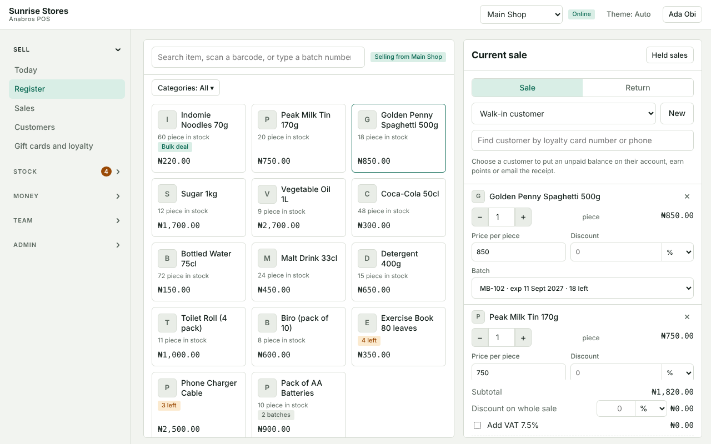
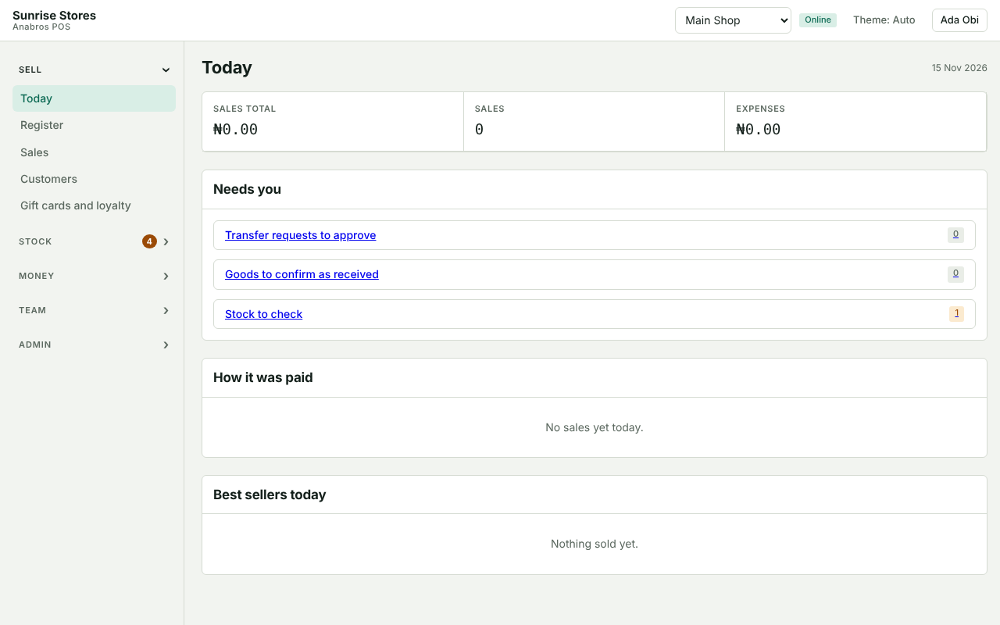
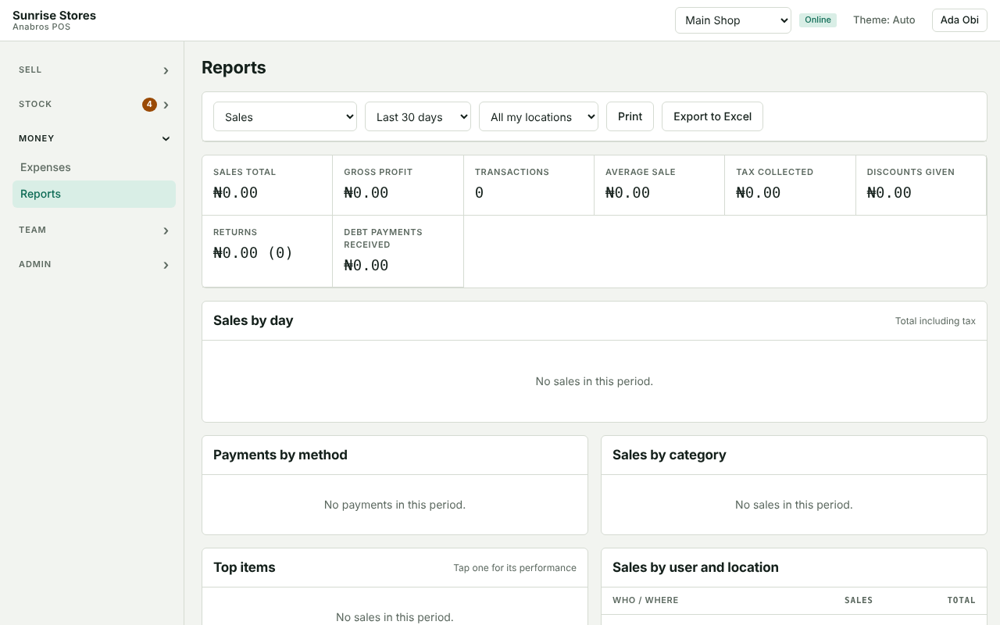
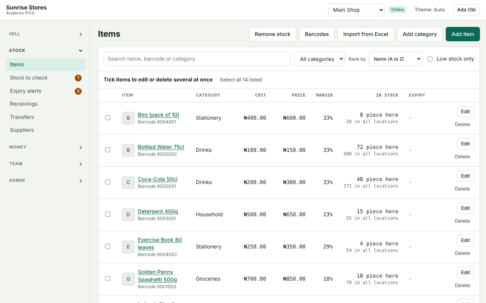
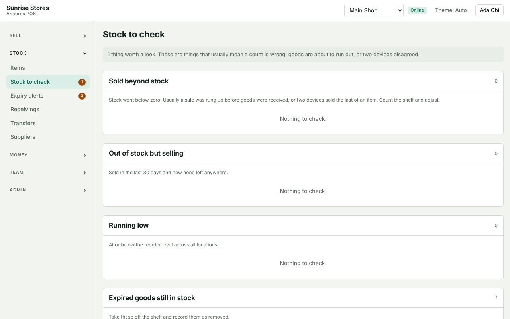

# Anabros POS, local edition

For a shop with one computer (or one computer per shop) that does not need to be watched from far away. **Everything stays on the computer.** There is no server, no hosting, no account, and the app never uses the internet.

> **Your data lives only in this browser on this computer. Back it up every week** (Settings, copy a backup) and keep the copy on a USB drive or send it to yourself. If the browser's site data is cleared or the computer fails, a backup is the only way back.

## Start in two minutes
1. Put `anabros-pos-local.html` in a folder you will not move or delete, for example `Documents\Anabros POS`.
2. Double-click it. It opens in your browser (Chrome or Edge works best).
3. Enter your business name and create the first admin account. **Write down the recovery code it shows you.**
4. Add a second admin (Users), and copy a backup (Settings).

Always open the shop from the **same file in the same browser**. Your data is stored in that browser for that file, so opening a copy from another folder, or using another browser, shows an empty shop. If you want a shortcut, right-click the file and create one, or pin the page in your browser.

## What you get
Everything in the main version except the server features: register, returns, held sales, gift cards, loyalty, customers who owe, batches and expiry, receivings, transfers between your locations (with goods on the way and a count of what arrived), Today, Stock to check, reports, users with permissions, activity log, messages, import and export, and a collapsible menu.

You can still have several locations (for example a shop and a store room) and several people with their own accounts on the one computer.

## Sign ins and working hours
Closing the window or switching the computer off signs people out. Each sign in is recorded as a shift, with the time signed in and the time actually in use. Open **Activity and sign ins** to see who worked when, for any week, month or dates you choose.

| | |
|---|---|
|  |  |
|  |  |

## What it does not do
- No syncing between computers or phones, and no watching sales from another place. For that, use the server version.
- No cloud backup. **You are the backup.** In Settings, copy a backup every week and keep it on a USB drive or send it to yourself. Clearing the browser's site data deletes the shop, so a backup is your only way back.
- Excel exports are CSV files (Excel opens them). The local edition does not load anything from the internet.

## Locked out?
See `docs/EMERGENCY-RESET.md` in this folder.

## Need syncing or remote access?
If you later want to connect your shop to a server and use the online options, such as syncing several computers and phones, watching sales and who is online from anywhere, or phone access for your managers, contact us at **feedback4anabrospos@protonmail.com** and we will help you move over. Your data comes with you (see below).

## Moving to the server version later
Settings, copy a backup. Then on the welcome screen of the server version, choose **Create account** and pick that backup file. Your items, customers, sales and users come across.

Ideas and feedback: feedback4anabrospos@protonmail.com. Bugs: open an issue in the project's GitHub Issues. Please include the version number from the bottom of Settings.

Free and open source (MIT license).
